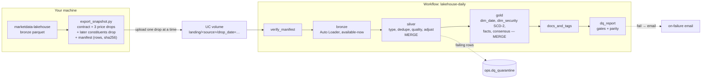

# databricks-lakehouse-lab

The bronze/silver/gold equities pipeline from
[marketdata-lakehouse](https://github.com/narasimhamungi/marketdata-lakehouse), ported from
pandas and Postgres to PySpark, Delta Lake and Databricks Workflows. It loads a verified snapshot
in daily drops, keeps every load idempotent with Delta `MERGE`, builds an SCD-2 security dimension,
and checks its reconciliation counts against the original pipeline's report.

**On 778,341 real price rows, the Spark port reproduces the original pipeline's cross-vendor
reconciliation exactly: 63,575 compared, 1,262 flagged, 635,830 yfinance-only, 15,361 Tiingo-only.**

## Status

| | |
|---|---|
| Code, tests, bundle, Day 0 probe | Built |
| Tests | 88 (77 on plain Spark, 11 on Delta Lake) |
| Local run on real data | Done: parity with the original pipeline matches (below) |
| Databricks run | **Not yet run.** The Platform section and the Databricks results are filled from that run, not estimated |

## Results

### Local run on real data

Local Spark 4.0.1 with Delta Lake 4.0.0 (Docker), the full snapshot in one run.

| Reconciliation | Spark port | Original pipeline (pandas, 2026-09-08 report) |
|---|---|---|
| (ticker, date) pairs compared | 63,575 | 63,575 |
| Flagged above 0.5% | 1,262 | 1,262 |
| yfinance only | 635,830 | 635,830 |
| Tiingo only | 15,361 | 15,361 |

- **Silver:** 699,405 yfinance rows (370 tickers) and 78,936 Tiingo rows (42 tickers).
- **Overlap day:** the day re-sent in the last drop was removed exactly once: 370 yfinance, 42 Tiingo and 2 FRED rows.
- **Gold:** 778,341 rows in `fact_price_daily`, every one with a security and a date key, and 714,766 in `fact_price_daily_consensus`.
- **Quality:** 36 gates, 0 failed. One row was quarantined as a warning and kept in silver: HUBB on 2021-05-05, where the low (196.21) is above the open (195.98). This is the vendor bad print the original pipeline documented.

The drop-by-drop table (incremental loads, SCD-2 on the 2026-10-07 snapshot, idle re-run) is produced by `scripts/run_local.py` and `scripts/render_results.py`; see docs/RUNBOOK.md.

## Why this exists

marketdata-lakehouse proved the data design locally: five sources, a quality suite, cross-vendor
reconciliation, and a star schema in Postgres. This repo asks whether the same design holds on a
lakehouse platform, where loads are incremental and must be safe to re-run, and where governance
lives in the catalog rather than in a README.

## Architecture



| Layer | Tables | What happens |
|---|---|---|
| Bronze | `yfinance_prices`, `tiingo_prices`, `constituents`, `openfigi_mapping`, `fred_series` | Append-only. Every row carries `_source_file`, `_file_modified_at`, `_drop_date` and `_ingested_at`. A checkpoint means a file is read once. |
| Silver | `prices_yfinance`, `prices_tiingo`, `constituents`, `figi_map`, `macro_rate` | Typed, deduplicated (the latest drop wins), and quality-checked. Adjusted O/H/L are derived for yfinance and native for Tiingo. `MERGE` only lets a newer drop overwrite an older one. |
| Gold | `dim_date`, `dim_security`, `fact_price_daily`, `fact_price_daily_consensus`, `fact_macro_rate` | The Postgres star schema on Delta. `dim_security` is SCD-2 via the staged-updates `MERGE`. The consensus fact carries the reconciliation flag. |
| Ops | `dq_quarantine`, `dq_results`, `task_metrics`, `reconciliation_runs` | What each run read, wrote, rejected and decided. |

## What carries over from the original, and what changed

**Ported as-is.**

- 0.5% symmetric `adj_close` tolerance, measured against the mean of the two vendors.
- yfinance as the primary source, because it has the wider coverage (370 tickers against Tiingo's 42-ticker sample).
- `is_trading_day` derived from the data rather than a holiday calendar.
- SCD-2 on company name, GICS sector and sub-industry, and FIGI.
- 99.99% tolerance on OHLC ordering, since one vendor bad print in ~950K rows is noise.
- Zero tolerance on nulls and non-positive prices.

**Changed, and why.**

- **Point-in-time fact keys.** Each price keys to the `dim_security` version in effect on its date. The first version also covers dates before the first snapshot, and the latest version stays open after a removal. The original keys every fact to the current row, which means an attribute change re-keys history on the next reload (duplicate facts under the old and new key) and a removal orphans the ticker's history.
- **Incremental loads.** The original re-pulls full history every run. Here, data arrives in dated drops, so dedupe keeps the latest drop, and the silver `MERGE` refuses to let an older drop overwrite a newer one.
- **Deterministic surrogate keys.** `security_key = xxhash64(ticker, effective_from)` replaces a `SERIAL`, so rebuilding the dimension gives the same keys.
- **One extra rule.** `adj_close_not_null` is added, because the consensus fact declares `adj_close NOT NULL`.

**Not ported.** `fact_corporate_action`, the Airflow DAG (replaced by the Workflow) and live API ingestion. Free Edition restricts outbound traffic, so the data arrives as an exported snapshot.

## Methods worth a look

- **Manifest before anything else.** The export records row count and sha256 per file. The first task fails the run on any mismatch, missing file or unexpected file, and it has no retries, because re-running a hash mismatch only delays the alert.
- **Idempotent at every layer.**
  - Bronze relies on the stream checkpoint, or in batch mode on an anti-join over `_source_file`.
  - Silver and gold `MERGE` statements update a row only when a compared column actually changed, using NULL-safe `<=>`.
  - A re-run with nothing new should therefore write 0 rows everywhere. `test_rerunning_everything_changes_nothing` asserts it, and step 4 of the runbook records it on Databricks.
- **One set of quality rules, two engines.** Rules are null-safe SQL strings in `lakehouse/quality.py`. The job path splits rows into clean and quarantine with them. The optional declarative pipeline turns the same strings into `expect_or_drop` and `expect`.
- **Parity with the original.**
  - The export parses marketdata-lakehouse's reconciliation report for the same snapshot.
  - After the last drop, `dq_report` compares the Spark port's compared, flagged, yfinance-only and Tiingo-only counts with it, and fails the run on a mismatch.
  - Earlier drops report `pending`, because the reference covers the whole snapshot.
- **SCD-2 on a real index change.** A later constituents snapshot (2026-10-07) is landed as a fourth drop. Between the two snapshots, 6 tickers were added (BE, ILMN, P, SKYD, TWLO, VYLR) and 6 removed (BLDR, CTVA, PSKY, TAP, TTD, WBD), with no attribute changes. The removed tickers' rows are closed and their price history keeps its keys.
- **Spark Connect-safe.** Serverless jobs run on Spark Connect, so writes go through SQL `MERGE` on temp views rather than the `DeltaTable` Python API. Nothing touches `sparkContext`.

## Platform

_Day 0 probe results go here (`notebooks/00_capability_probe.py`). Only checks that pass are claimed._

## Tests and CI

88 tests:

- **77 run on plain Spark.** They cover the export and its landing contract (including extra constituents snapshots), manifests, the streaming file source reading each file exactly once, typing, dedupe, adjustment, every quality rule and the gate, `dim_date`, SCD-2 classification and staging, reconciliation, point-in-time key matching, the `MERGE` SQL builders, the bundle's structure, the local runner and the helper scripts.
- **11 need Delta Lake** (marked `delta`). They build the whole pipeline over three drops and check:
  - bronze, silver and gold row counts;
  - that the overlap day is not rewritten;
  - quarantine contents;
  - reconciliation parity;
  - a full re-run changing nothing;
  - the strict gate failing;
  - a parity mismatch failing;
  - batch-mode idempotency;
  - Delta evidence;
  - an SCD-2 `MERGE` on a new snapshot that leaves existing facts and the calendar untouched.

CI (GitHub Actions: Java 17, Python 3.12, PySpark 4.0.1, delta-spark 4.0.0) sets `REQUIRE_DELTA=1`, so the Delta tests fail rather than skip if the jars don't load.

```bash
pip install -e ".[dev]"
pytest            # Delta tests are skipped when the Delta jars can't be fetched
ruff check . && ruff format --check .
```

## Reproduce

See [docs/RUNBOOK.md](docs/RUNBOOK.md).

**Locally**, with Docker only: export the snapshot, then `scripts/run_local.py` loads the drops one at a time in a single Spark session, re-runs with nothing new, and writes the reports `scripts/render_results.py` turns into the tables above.

**On Databricks**, in outline:

1. Run the Day 0 probe.
2. Export the snapshot.
3. `databricks bundle deploy`, then run `lakehouse_setup`.
4. Upload and run each drop.
5. Re-run with nothing new.
6. Run one deliberate failure.
7. Run `lakehouse_delta_evidence`.
8. Render the results.

## Limitations

- **Databricks Free Edition.** Serverless only, non-commercial use, restricted outbound internet, one active pipeline per type, and five concurrent job tasks.
- **Snapshot data, not live feeds.** Drops simulate daily arrival from one verified export. There is no real-time or streaming claim beyond Auto Loader's available-now trigger over files.
- **Single user.** GRANT, row filters and column masks are probed but not part of the design.
- **Small data.** Under a million price rows, so OPTIMIZE timings are reported as measured, not presented as a speed-up.
- **Coverage of the source snapshot.** yfinance has prices for 370 of the 503 constituents. Tiingo is a 42-ticker sector-stratified sample; 34 overlap yfinance and 8 do not. These gaps are in marketdata-lakehouse's ingestion, not introduced here.
- **FIGI.** The source's OpenFIGI mapping covers 3 tickers, so `figi` is NULL for 500 of 503 securities. SCD-2 tracks it; the data barely exercises it.
- **Snapshot label.** The bronze partition labelled 2026-09-08 holds prices through 2026-09-09; the label is the ingestion run's, not a cut-off.
- **Inherited from the original.** Volume is not split-adjusted. Constituents come from the original's scraped list, not an index provider.
- **Not Azure.** The Free Edition docs don't say which cloud hosts it, so nothing here is described as Azure Databricks.

## Not claimed

Azure Databricks, Data Factory, ADLS, Event Hubs, Kafka, Purview, Scala, Terraform, Azure DevOps, MLOps.
Pipeline expectations, Auto Loader and tags are claimed only if the Day 0 probe passes them.

## Layout

```
src/lakehouse/      transforms and tasks (DataFrame in, DataFrame out; delta_io does the writes)
jobs/               thin entry points, one per workflow task
pipelines/          optional Lakeflow declarative pipeline (same quality rules)
notebooks/          Day 0 capability probe
scripts/            export_snapshot, upload_drop, run_local, render_results
databricks.yml      asset bundle: jobs, optional pipeline target
tests/              pytest on local Spark; `delta`-marked tests need the Delta jars
```

MIT licence.
