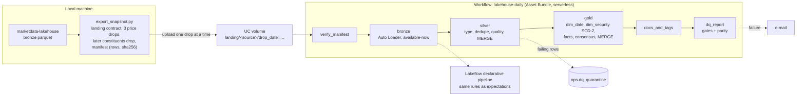
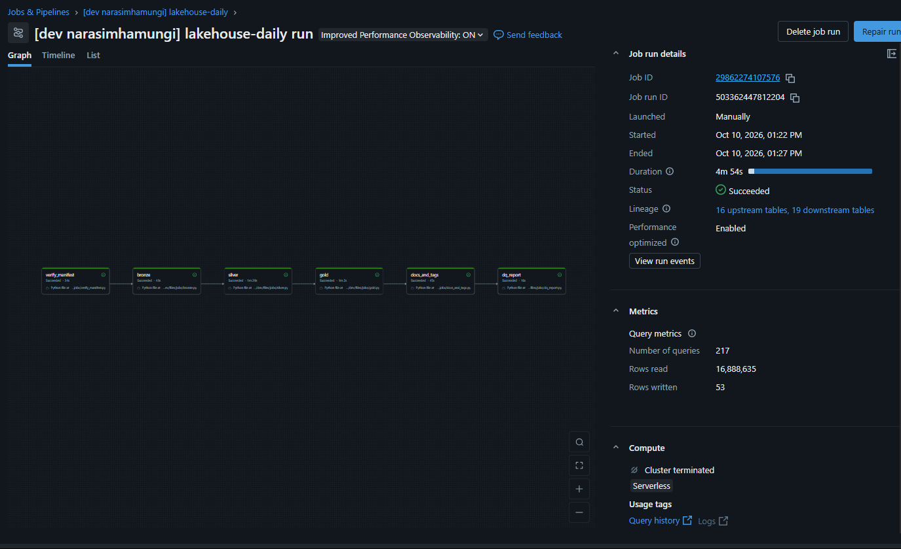

# databricks-lakehouse-lab

The bronze/silver/gold equities pipeline from
[marketdata-lakehouse](https://github.com/narasimhamungi/marketdata-lakehouse), rebuilt on
PySpark, Delta Lake, Databricks Workflows and Unity Catalog. It loads a verified market-data
snapshot in daily drops with Auto Loader, keeps every load idempotent with Delta `MERGE`, builds an
SCD-2 security dimension, applies one set of quality rules in both a job and a declarative
pipeline, and checks its reconciliation against the original pipeline's report.

**On Databricks serverless, over 778,341 real price rows, the port reproduces the original
pipeline's cross-vendor reconciliation exactly (63,575 compared, 1,262 flagged, 635,830
yfinance-only, 15,361 Tiingo-only), and every table-level count matches a local Spark run of the
same code.**

| | |
|---|---|
| Databricks run | Done 2026-10-10/12 on Databricks Free Edition (serverless, Databricks Runtime 19.9, catalog `lakehouse_lab`) |
| Local run | Done 2026-10-09 (Spark 4.0.1, Delta Lake 4.0.0, Docker): identical numbers |
| Tests | 102 (91 on plain Spark, 11 on Delta Lake); CI green on every push |
| Evidence | [`outputs/databricks/`](outputs/databricks/) (run reports, Delta and pipeline evidence, retry record) and [`docs/screenshots/`](docs/screenshots/) |

## Problem

marketdata-lakehouse proved a data design locally: five sources, a quality suite, cross-vendor
price reconciliation and a star schema in Postgres, rebuilt from scratch on every run. On a
lakehouse platform the same design has to survive three things the local version never faced:
data that arrives incrementally, loads that must be safe to re-run, and governance that lives in the
catalog rather than in a README.

## What was built



| Layer | Tables | What happens |
|---|---|---|
| Bronze | `yfinance_prices`, `tiingo_prices`, `constituents`, `openfigi_mapping`, `fred_series` | Append-only via Auto Loader. Every row carries `_source_file`, `_file_modified_at`, `_drop_date`, `_ingested_at`; the checkpoint reads each file once. |
| Silver | `prices_yfinance`, `prices_tiingo`, `constituents`, `figi_map`, `macro_rate` | Typed, deduplicated (latest drop wins), quality-checked. `MERGE` updates a row only when a value changed and never lets an older drop overwrite a newer one. |
| Gold | `dim_date`, `dim_security`, `fact_price_daily`, `fact_price_daily_consensus`, `fact_macro_rate` | The Postgres star schema on Delta. `dim_security` is SCD-2 via a staged-updates `MERGE`; facts key to the dimension version in effect on their date. |
| Ops | `dq_quarantine`, `dq_results`, `task_metrics`, `reconciliation_runs` | What each run read, wrote, rejected and decided. |

**Data and tools.** S&P 500 daily prices to 2026-09-09 from yfinance (370 tickers) and Tiingo (42-ticker
sample), constituents, OpenFIGI mapping and four FRED series, exported from marketdata-lakehouse.
PySpark 4, Delta Lake, Databricks Workflows, Auto Loader, Unity Catalog, Lakeflow Declarative
Pipelines, Databricks Asset Bundles and CLI, pytest and GitHub Actions.

## Results on Databricks

The four drops were uploaded and run one at a time (`lakehouse_daily --params run_date=<drop>`),
then the job ran again with nothing new. Output of `scripts/render_results.py` over the run reports:

| Drop | Bronze rows added (yfinance) | Silver yfinance inserted / updated | Silver Tiingo inserted / updated | dim_security new / changed / closed | Parity | Job time |
|---|---|---|---|---|---|---|
| 2026-09-04 | 698,665 | 698,665 / 0 | 78,852 / 0 | 503 / 0 / 0 | pending | 7m 15s |
| 2026-09-08 | 370 | 370 / 0 | 42 / 0 | – | pending | 4m 45s |
| 2026-09-09 (re-sends 09-08) | 740 | 370 / 0 | 42 / 0 | – | **match** | 4m 44s |
| 2026-10-07 (constituents only) | 0 | 0 / 0 | 0 / 0 | 6 / 0 / 6 | match | 6m 28s |
| Re-run, no new drop (twice) | 0 | 0 / 0 | 0 / 0 | – | match | 4m 54s, 6m 45s |

| Reconciliation | Spark port on Databricks | Original pipeline (pandas, 2026-09-08 report) |
|---|---|---|
| (ticker, date) pairs compared | 63,575 | 63,575 |
| Flagged above 0.5% | 1,262 | 1,262 |
| yfinance only | 635,830 | 635,830 |
| Tiingo only | 15,361 | 15,361 |

- **Identical to the local run.** For all five runs, rows inserted and updated in every table, gate
  results, quarantine and parity match the local Docker run exactly.
- **Incremental and idempotent.** The 09-09 drop re-sent 09-08: 740 rows reached bronze and silver
  inserted only the 370 new ones. Both re-runs changed no rows in any of the 14 bronze, silver and
  gold writes.
- **SCD-2 on a real index change.** The 10-07 snapshot opened 6 securities (BE, ILMN, P, SKYD, TWLO,
  VYLR), closed 6 (BLDR, CTVA, PSKY, TAP, TTD, WBD) and left 497 unchanged. The fact reload after it
  inserted 0 rows and left 0 without a security key, so the removed tickers' history kept its keys.
- **Gold:** 778,341 rows in `fact_price_daily`, 714,766 in `fact_price_daily_consensus`.
- **Quality:** 0 gates failed in any run. One row was quarantined as a warning and kept: HUBB on
  2021-05-05, where the low (196.21) is above the open (195.98), the vendor bad print the original
  pipeline documented.
- Job times are mostly serverless start-up across six tasks, not processing; they are not a
  performance claim.



## Platform evidence

**Day 0 probe** (`notebooks/00_capability_probe.py`, 2026-10-10, serverless). Every automated check passed:

| Check | Result |
|---|---|
| Create catalog, schema, volume; file I/O on the volume | PASS |
| Delta write, `MERGE`, `DESCRIBE HISTORY`, `VERSION AS OF` | PASS |
| Auto Loader available-now with checkpoint (re-run adds 0 rows); file-stream fallback | PASS |
| `OPTIMIZE`, `VACUUM` | PASS |
| Table and column comments, table tags | PASS |
| `GRANT` / `SHOW GRANTS`; row filter (3 rows, 2 visible) | PASS, probe only, not used by the pipeline |

**Operational checks on the real workflow:**

- **Asset Bundle deploy from the CLI** (OAuth login) of three jobs, plus a separate target for the pipeline.
- **Unity Catalog governance.** `docs_and_tags` applies 49 table/column comments and tags
  (`layer`, `domain`, `contains_pii`) with 0 failures on every run
  ([screenshot](docs/screenshots/catalog_docs_tags.png)). Unity Catalog records lineage for the
  job run: 16 upstream and 19 downstream tables.
- **Manifest gate.** A deliberately broken manifest row count fails the run at `verify_manifest`, skips
  every later task and sends the failure e-mail ([run](docs/screenshots/failed_run.png),
  [e-mail](docs/screenshots/failure_email.png)). Since finding 1 below, it fails in one attempt.

## Delta Lake evidence

From `lakehouse_delta_evidence` on the real tables ([`delta_evidence.json`](outputs/databricks/reports/delta_evidence.json)):

- **Time travel.** Silver yfinance row count by version: 0 → 698,665 → 699,035 → 699,405, flat after.
- **Schema enforcement.** An append with an extra column and no `mergeSchema` is rejected
  (`DELTA_METADATA_MISMATCH`). Writing strings to a `DOUBLE` column behaves differently: `'not a number'`
  fails as a cast error, but `'3.25'` is accepted and stored as 3.25 (Databricks casts on append).
- **Schema evolution.** The same append with `mergeSchema` adds the column; earlier rows read NULL.
- **OPTIMIZE.** Bronze yfinance went from 3 streaming files to 1 (commit 9, written by the evidence
  job). On a scratch table with auto-compaction off, 8 single-row appends compact to 1 file.
- **Predictive optimization.** Enabled on the schema. Silver yfinance commit 13 is an `OPTIMIZE` that no
  task here runs: it was written by Databricks' "Predictive Optimization Job" and merged 12 files into 1.
- **VACUUM** with the default 7-day retention: 0 files eligible yet.

## One rule set, two engines

The quality rules are null-safe SQL strings in `lakehouse/quality.py`. The job path uses them to split
rows into clean and quarantine; the Lakeflow declarative pipeline (`pipelines/dq_expectations.py`)
turns the same strings into `expect_or_drop` and `expect`. Run over the same bronze tables, the pipeline
finds exactly one violation, on the rule and count the job path quarantined
([`pipeline_expectations.json`](outputs/databricks/reports/pipeline_expectations.json)):

| Dataset | Rows | Expectations | Failed | Dropped |
|---|---|---|---|---|
| yfinance | 699,775 | 13 | 1 (`low_le_open`; the job path's one warning is HUBB 2021-05-05) | 0 |
| Tiingo | 78,978 | 13 | 0 | 0 |

## Findings from running it

1. **`max_retries: 0` is not at-most-once on serverless.** Serverless auto-optimization retried the
   failed manifest check anyway: every failed run made 2 attempts. Setting
   `disable_auto_optimization: true` on the gate tasks made it 1
   ([`run_attempts.json`](outputs/databricks/run_attempts.json)). A pipeline task showed the same
   pattern: six pipeline updates inside one 12-minute job run with no retries configured.
2. **Destroying a declarative pipeline does not free its tables.** After `bundle destroy`, the
   pipeline's materialized views stayed, still "managed by" the deleted pipeline, and every new
   pipeline failed on them. A published event-log table outlived it the same way. The fix: new view
   names, the pipeline kept deployed, and expectation counts read with `event_log(TABLE(<view>))`.
3. **Databricks casts on append.** Schema enforcement rejects structural mismatches, not every type
   mismatch: a numeric string goes into a `DOUBLE` column.
4. **Some maintenance is not yours.** Predictive optimization compacted silver on its own; the commit
   history (job name per commit) is the way to tell which compactions a pipeline caused.
5. **"Changed no rows" is not "wrote nothing".** A re-run commits Delta versions (a no-op `MERGE`,
   re-applied comments) and logs itself in the ops tables, including the HUBB warning again, because a
   re-run without a drop date re-checks all of bronze.

## Methodology

**Ported as-is from the original:** 0.5% symmetric `adj_close` tolerance against the mean of the two
vendors; yfinance as primary source (wider coverage); `is_trading_day` derived from the data; SCD-2 on
company name, GICS sector and sub-industry, and FIGI; 99.99% tolerance on OHLC ordering; zero tolerance
on nulls and non-positive prices.

**Changed, and why:**

- **Point-in-time fact keys.** Each price keys to the `dim_security` version in effect on its date (the
  first version also covers earlier dates; the latest stays open after a removal). The original keys
  facts to the current row, which re-keys history after an attribute change and orphans a removed
  ticker's history.
- **Incremental loads.** Data arrives in dated drops; dedupe keeps the latest drop, and the silver
  `MERGE` refuses to let an older drop overwrite a newer one.
- **Deterministic surrogate keys.** `security_key = xxhash64(ticker, effective_from)`, so a rebuild
  gives the same keys.
- **One extra rule.** `adj_close_not_null`, because the consensus fact declares `adj_close NOT NULL`.

**Other design points:**

- **Manifest before anything else.** The export records row count and sha256 per file; the first task
  fails on any mismatch, missing or unexpected file, with no retries.
- **Parity with the original.** The export parses marketdata-lakehouse's reconciliation report;
  `dq_report` compares counts after the last drop and fails the run on a mismatch (earlier drops report
  `pending`).
- **Spark Connect-safe.** Serverless runs on Spark Connect, so writes are SQL `MERGE` on temp views, not
  the `DeltaTable` Python API, and nothing touches `sparkContext`.

**Not ported:** `fact_corporate_action`, the Airflow DAG (replaced by the Workflow) and live API
ingestion (Free Edition restricts outbound traffic, so data arrives as an exported snapshot).

## What this demonstrates

A pandas/Postgres batch design carried onto a lakehouse without losing correctness: incremental
Auto Loader ingestion, idempotent Delta `MERGE` at every layer, SCD-2 with point-in-time keys,
Unity Catalog governance, a Workflow deployed as code, and data quality enforced the same way in two
engines, all proven against an independent reference and a local run rather than asserted. The
findings section is the operational part: each one came from a run that did not behave as configured,
was traced to its cause and fixed.

## Tests and CI

102 tests. 91 run on plain Spark: export and landing contract, manifests, the file stream reading each
file once, typing, dedupe, adjustment, every quality rule and gate, `dim_date`, SCD-2, reconciliation,
point-in-time keys, the `MERGE` SQL builders, the bundle's structure (including that every referenced
job parameter is declared and that no-retry tasks disable auto-optimization), event-log parsing and the
scripts. 11 need Delta Lake and build the whole pipeline over three drops (row counts, overlap day not
rewritten, quarantine, parity, full re-run changing nothing, failing gates, batch-mode idempotency,
Delta evidence, SCD-2 on a new snapshot).

CI (GitHub Actions: Java 17, Python 3.12, PySpark 4.0.1, delta-spark 4.0.0) sets `REQUIRE_DELTA=1`, so
the Delta tests fail rather than skip if the jars don't load.

```bash
pip install -e ".[dev]"
pytest
ruff check . && ruff format --check .
```

## Reproduce

[docs/RUNBOOK.md](docs/RUNBOOK.md) goes from a fresh Free Edition workspace to every number above:
probe, export, local reproduction (Docker only), `databricks bundle deploy`, setup, drop-by-drop loads,
the deliberate failure, Delta evidence, the declarative pipeline, and rendering the results.

## Limitations

- **Databricks Free Edition**, serverless only, on AWS (`metastore_aws_us_east_2`). Nothing here is Azure.
- **Snapshot data, not live feeds.** Drops simulate daily arrival from one verified export; no
  streaming claim beyond Auto Loader's available-now trigger over files.
- **Single user.** `GRANT` and row filters are probed, not part of the design.
- **Small data.** Under a million price rows, so OPTIMIZE timings are not presented as a speed-up.
- **Source coverage.** yfinance has prices for 370 of 503 constituents; Tiingo is a 42-ticker sample
  (34 overlap yfinance). OpenFIGI maps 3 tickers, so `figi` is NULL for 500 securities. The bronze
  partition labelled 2026-09-08 holds prices through 09-09. All inherited from marketdata-lakehouse.
- **Retries on transient tasks** (bronze, silver, gold, docs) are configured but never fired in these runs.

## Not claimed

Azure Databricks, Data Factory, ADLS, Event Hubs, Kafka, Purview, Scala, Terraform, Azure DevOps, MLOps.

## Layout

```
src/lakehouse/      transforms and tasks (DataFrame in, DataFrame out; delta_io does the writes)
jobs/               thin entry points, one per workflow task
pipelines/          Lakeflow declarative pipeline (same quality rules as expectations)
notebooks/          Day 0 capability probe
scripts/            export_snapshot, upload_drop, run_local, render_results
databricks.yml      asset bundle: `dev` (workflow jobs), `dev_pipeline` (pipeline + its evidence job)
outputs/databricks/ run reports and evidence from the Databricks run
docs/               runbook, screenshots
tests/              pytest on local Spark; `delta`-marked tests need the Delta jars
```

MIT licence.
